# オーディション採点アプリ 運営・トラブル対応マニュアル

本マニュアルは、渉外・運営委員（管理者）の方が、オーディションの事前準備から当日運営、結果公開・集計、次年度への引き継ぎまでを迷わず安全に行うための操作ガイドです。

---

## はじめに：画面の基本構成

ログインすると、画面上部にメニュータブが表示されます。管理者には次の5つのタブが表示されます（一般部員には「採点」「バンド登録」「集計」の3つのみ表示されます）。

| タブ名 | 用途 | 使える人 |
| :--- | :--- | :--- |
| **採点** | 演奏を見ながら点数・コメント・全体講評を入力する画面 | 全部員 |
| **バンド登録** | 出演バンドとメンバーを登録・確認する画面 | 全部員（※締切後は管理者のみ編集可） |
| **集計** | ランキング・バンド別講評・全体講評・提出状況の確認とExcel出力 | 全部員（※公開前は管理者のみ） |
| **設定** | イベントの新規作成、進行ステータス切替、締切・義務・出演順の設定 | 管理者のみ |
| **部員管理** | 全イベント共通の部員名簿の登録・削除、管理者権限の付与 | 管理者のみ |

### イベント切替ヘッダーの見方
「採点」「バンド登録」「集計」「設定」の画面上部には **「表示中のイベント」** が表示されます。
- 右側のプルダウンから、操作したいイベントを切り替えられます（開催日が新しい順に並びます）。
- 操作や入力をする前に、**正しいイベントが選ばれているか** を必ず確認してください。
- 一覧を見やすく保つため、**開催日から半年以上前のイベントは自動で非表示** になります。過去のイベントを見たいときは、「設定」タブ最下部「5. 詳細設定・削除」にある **「半年以上前のイベントを表示」** スイッチをオンにしてください。

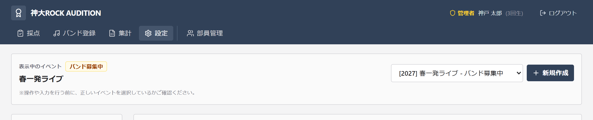

---

## 1. 事前準備の流れ（オーディション開催前）

### Step 1：部員名簿の登録・更新（新入生や未登録部員がいる場合）
部員は事前に名簿へ登録しておくことで、学内Googleアカウントでログインできるようになります。

1. 上部メニューから **「部員管理」** タブを開きます。
2. 画面下部の **「部員マスタ 一括登録・更新」** で、次のいずれかの方法で登録します。
   - **方法A：大学提出用の部員名簿Excelをそのまま読み込む（おすすめ）**
     1. **「ファイルを選択」** ボタンを押し、部員名簿の `.xlsx` / `.xls` / `.csv` ファイルを選びます。
     2. 上部のタイトル行、顧問教員、空行、下部の記入例などは自動で除外されます。「学籍番号列」「氏名列」が正しく選ばれているかプレビューで確認してください。
        - ※ 選んだ「学籍番号」と「氏名」以外の情報（電話番号やメールアドレスなど）はサーバーに送信されません。
     3. **「この ○ 名を新規登録（重複はスキップ）」** ボタンを押します。
   - **方法B：Excelからコピー＆貼り付けで登録する**
     1. Excelで「学籍番号」と「氏名」の2列をコピーし、テキスト欄に貼り付けます（順番が「氏名・学籍番号」でも自動判別されます）。
     2. **「貼り付け内容を登録（重複はスキップ）」** ボタンを押します。

> **ポイント**
> - すでに登録済みの部員は自動でスキップされるため、名簿全体をそのまま読み込んでも重複しません。
> - 回生は入部年度から **毎年4月基準で自動計算** されるため、毎年の手動変更は不要です。
> - 一括登録した部員は、初回ログイン時に **「氏名・回生（入部年度）の登録」** 画面が表示されます。自分の氏名（苗字と名前の間にスペース）と回生を確認して確定してもらってください。

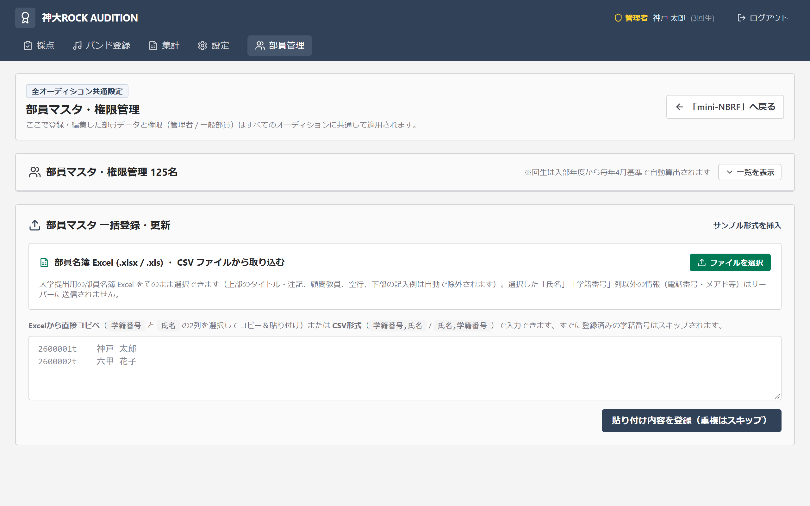

---

### Step 2：新しいイベントの作成（「1. バンド募集中」）
1. 上部メニューから **「設定」** タブを開きます。
2. 画面上部のイベント選択欄の横にある **「＋ 新規作成」** ボタンを押します（イベントが1件もない場合は画面中央の **「新規オーディションを作成」** ボタンを押します）。
3. 次の項目を入力し、**「作成して募集開始」** を押します。
   - **イベント名（必須）**：例 `六甲祭`、`秋イベ`、`NBRF` など
     - ※ 年度は開催予定日から自動表示されるため、名前に年号を入れなくて大丈夫です。
   - **開催予定日（必須）**：イベントの一覧順や年度表示に使われます（未確定の場合は目安の日付で構いません）。
   - **バンド募集締切（必須）**：この日時を過ぎると、ステータスが「バンド募集中」のままでも一般部員のバンド登録・編集が自動でロックされます。
   - **採点締切（任意）**：未入力のまま作成できます（当日「採点受付中」に切り替える際に設定できます）。
4. 作成直後は **「1. バンド募集中」** の状態で開始されます。

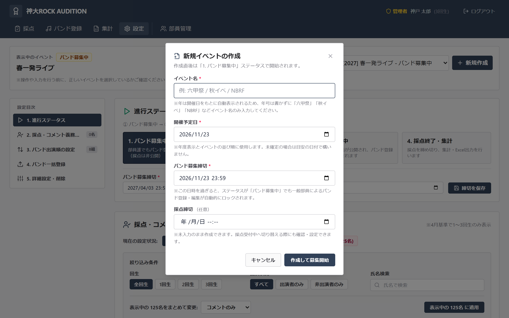

---

### Step 3：出演バンドの登録
バンドの登録方法は2通りあり、併用もできます。

- **方法A：部員自身に登録してもらう（基本）**
  - ステータスが **「1. バンド募集中」** かつ **バンド募集締切前** の間は、全部員が **「バンド登録」** タブの **「＋ バンドを登録」** ボタンから自分のバンドを登録・編集できます。
  - メンバーは部員名簿（現役の1〜3回生）から検索して選ぶ方式のため、名前の表記揺れが起きません。

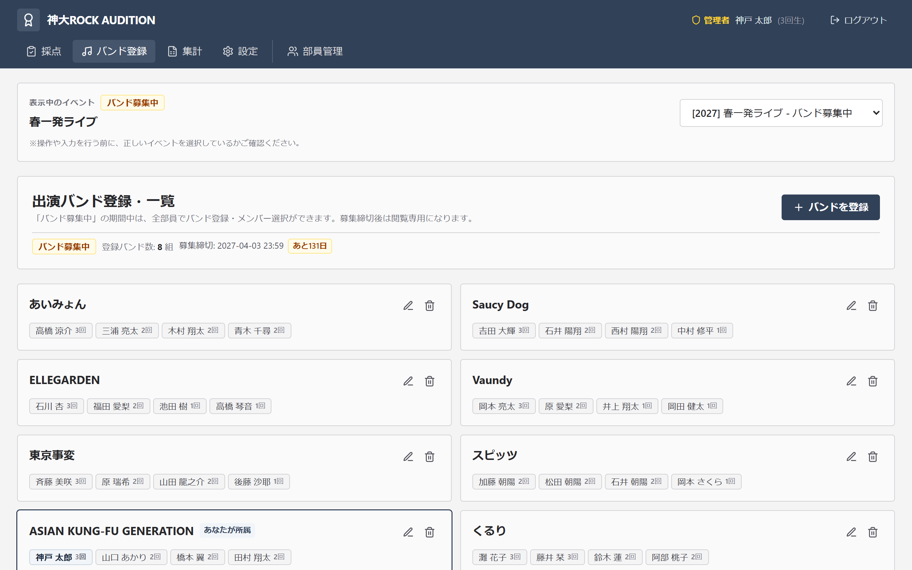

- **方法B：運営側でまとめて登録する**
  - **「設定」** タブの **「4. バンド一括登録」** を開き、`出演順,バンド名,メンバー1 / メンバー2` の形式で入力（Excelからの貼り付け可）し、**「バンド一括登録を実行」** を押します。
  - 既存のバンドを残して追加するか、「既存のバンド一覧をすべて置き換える」にチェックを入れて入れ替えるかを選べます。

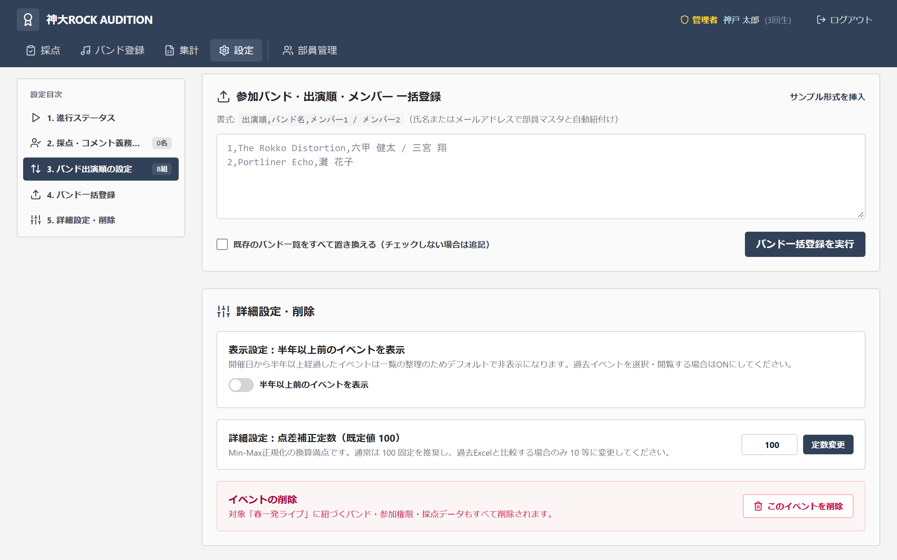

---

### Step 4：募集締切・出演順の決定・採点義務の設定
バンドの応募が締め切られたら、当日に向けて次の3つを設定します。

1. **募集を締め切る（「2. 募集締切・調整中」）**
   - **「設定」** タブの **「1. 進行ステータス」** で **「2. 募集締切・調整中」** を押します。
   - 一般部員は「バンド登録」タブの閲覧のみとなり、運営（管理者）だけがバンドの編集・調整を行えます。
   - ※ 応募バンド数が少なくオーディション不開催になった場合は、そのまま「4. 採点終了・集計」に切り替えて終了できます。

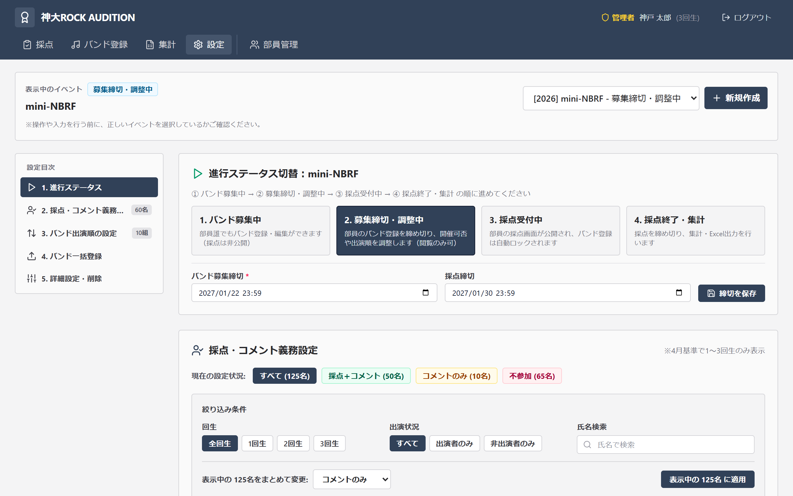

2. **バンドの出演順を決める（「3. バンド出演順の設定」）**
   - **「設定」** タブの **「3. バンド出演順の設定」** を開きます。
   - `1バンド目` 〜 `○バンド目` の各枠のプルダウンからバンドを選びます。
   - すでに別の枠に入っているバンドを選ぶと、**自動で枠同士が入れ替わります**。最初から組み直したいときは **「すべてクリア」** ボタンを押します。
   - すべての枠を埋めたら **「出演順を保存」** を押して確定します。

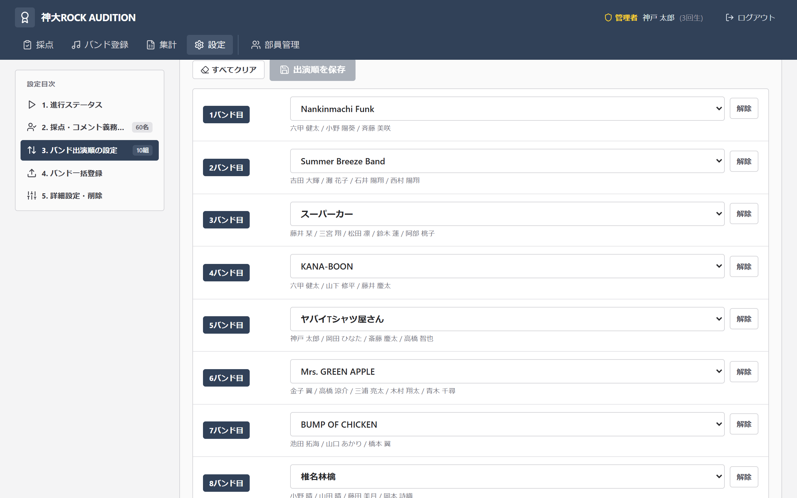

3. **採点・コメント義務を設定する（「2. 採点・コメント義務設定」）**
   - **「設定」** タブの **「2. 採点・コメント義務設定」** を開きます（4月基準で1〜3回生のみ表示されます）。
   - 上部の絞り込み条件（**現在の設定状況**・**回生**・**出演状況**・**氏名検索**）で対象者を絞り込み、下の「表示中の ○ 名をまとめて変更」から一括設定するか、各行の右側にあるボタンで個別に設定します。
     - **採点＋コメント**：点数（魅力50点・技術50点）とコメント・全体講評の両方を提出する部員
     - **コメントのみ**：1回生や見学枠など、点数なしでコメント・全体講評のみ提出する部員
     - **不参加**：オーディションに参加・採点しない部員（採点画面を開くと「対象外」と表示されます）

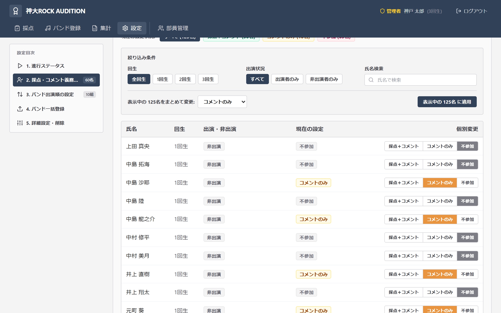

---

## 2. オーディション当日の運用手順

### Step 1：「3. 採点受付中」へ切り替える
1. 演奏開始前に **「設定」** タブの **「1. 進行ステータス」** から **「3. 採点受付中」** を押します。
2. 確認画面が開くので、**採点締切の日時** を確認・入力し、**「採点受付を開始する」** を押します。
   - もし以前に「採点受付中」だった別イベントがあれば、自動で「4. 採点終了・集計」に切り替わります。
   - 全部員の **「採点」** タブに今回のイベントが表示され、入力できるようになります。

> **採点締切を過ぎた後の動き**
> - **すでに提出済みの部員**：入力内容の変更ができなくなります。
> - **まだ提出していない部員**：すでに保存済みのバンドは変更できませんが、**未入力のバンド・全体講評だけ入力して初回提出** できます。
> - 締切を延長したい場合は、「設定」タブの「1. 進行ステータス」下部にある **「採点締切」** を変更して **「締切を保存」** を押してください。

---

### Step 2：部員へ案内しておくとスムーズな操作ポイント
部員がスマホから採点する際、次のポイントを共有しておくと問い合わせが減ります。
- **自分のバンドは自動で採点対象外** になります（複数バンド掛け持ちにも対応）。
- 各バンドの入力が終わったら **「採点を保存」** を押すと、カードが自動で折りたたまれ、スクロール中の誤操作を防げます。直したいときはカード右上の **「編集」** ボタンを押してください。
- 全バンドのあとに **「全体講評」** の入力も必須です。
- 画面下の **「マイ順位確認」** で自分が付けた点数・順位を確認し、最後に **「最終提出する」** を押して完了です（採点締切前なら何度でも「内容を更新提出する」で修正できます）。
- 会場の電波が悪いときは端末内に自動で下書き保存されます。電波の良い場所で上部の **「未同期 (○件) を同期」** ボタンを押せば送信されます。

| 採点画面（上部：自バンド除外・入力進捗） | 採点画面（下部：全体講評・マイ順位確認・提出） |
| :---: | :---: |
| 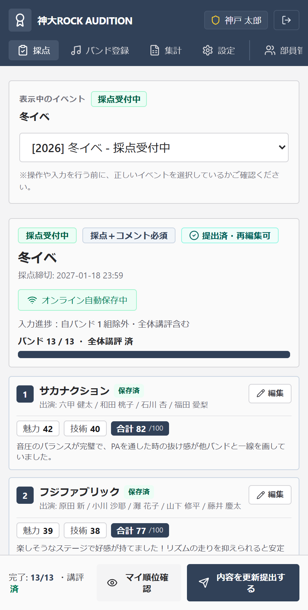 | 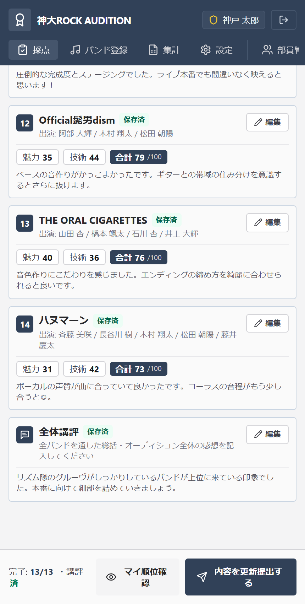 |

---

### Step 3：提出状況の確認と未提出者へのリマインド
1. 上部メニューから **「集計」** タブを開き、**「提出状況」** サブタブをクリックします。
2. **「未提出者のみ表示」** スイッチをオンにすると、まだ最終提出が終わっていない部員と入力進捗（例：`12 / 15 バンド`、全体講評 `入力済 / 未入力`）が一覧で確認できます。
3. **「未提出者リストをコピー」** ボタンを押すと、回生別に整理された未提出者一覧テキストがコピーされます。そのままLINEグループなどに貼り付けてリマインドできます。

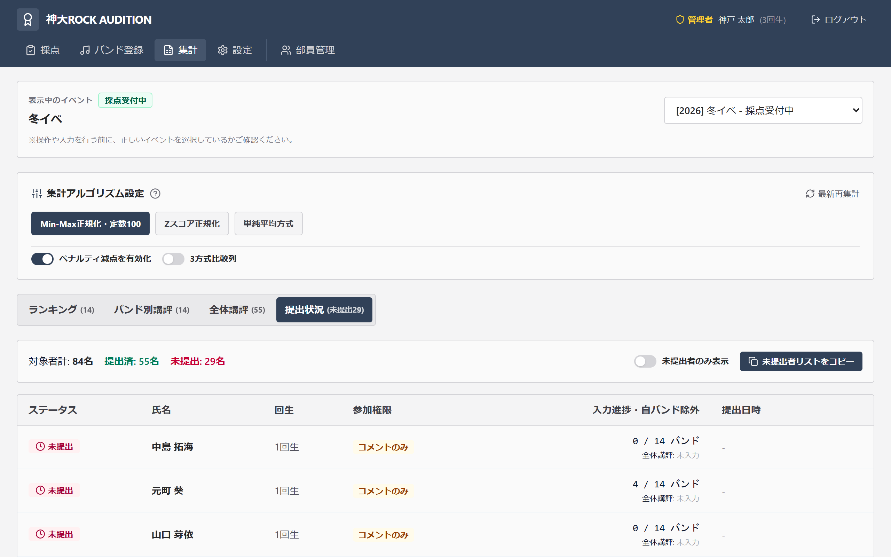

---

### Step 4：ペナルティ減点の入力と集計結果の確認
1. **「集計」** タブを開きます。
2. **採点必須（採点＋コメント）の部員に未提出者がいる間** は、ランキング・バンド別講評・全体講評は誤公開防止のため自動で非表示になっています。
   - 途中経過を運営だけで確認したい場合は、画面の **「未提出ありでもプレビュー表示する」** ボタンを押してください（一般部員には公開されません）。
3. **ペナルティ減点を設定する場合**：
   - 上部の **「ペナルティ減点を有効化」** スイッチをオンにします。
   - ランキング表の「ペナルティ減点」欄に減点数（例：`2.0`）を入力し、**「適用」** を押します。
   - ペナルティは生の点数や正規化計算を壊さず、最終スコアからのみ引き算されます。スイッチをオフにすればいつでも減点前の結果を確認できます。
4. **集計方式・タイブレークの確認・比較**：
   - 標準は **「Min-Max正規化・定数100」**（各審査員の最低点を0点・最高点を100点に揃える方式）です。
   - 必要に応じて **「Zスコア正規化」**（偏差値方式）や **「単純平均方式」** にワンクリックで切り替えたり、**「3方式比較列」** スイッチをオンにして並べて比較したりできます。
   - 各方式の詳しい違いは、「集計アルゴリズム設定」横の **「？」ボタン** から確認できます。
   - ※ 過去のExcel（10点満点換算など）と比較したい場合のみ、「設定」タブの「5. 詳細設定・削除」から点差補正定数を変更できます（通常は `100` のままにしてください）。
   - **同点時（タイブレーク）の順位決定ルール**：小数第4位で丸めた値をもとに、以下の優先順位で順位を決定します（すべて同一の場合は同率順位として同じ順位を付与し、出演順で表示します）。
     1. **有効投票数が1票以上あること**（0票のバンドは最下位グループ）
     2. **最終スコア（ペナルティ控除後）** が高い順
     3. **正規化平均合計（ペナルティ控除前）** が高い順
     4. **素点平均（合計）** が高い順
     5. **素点平均（技術点）** が高い順

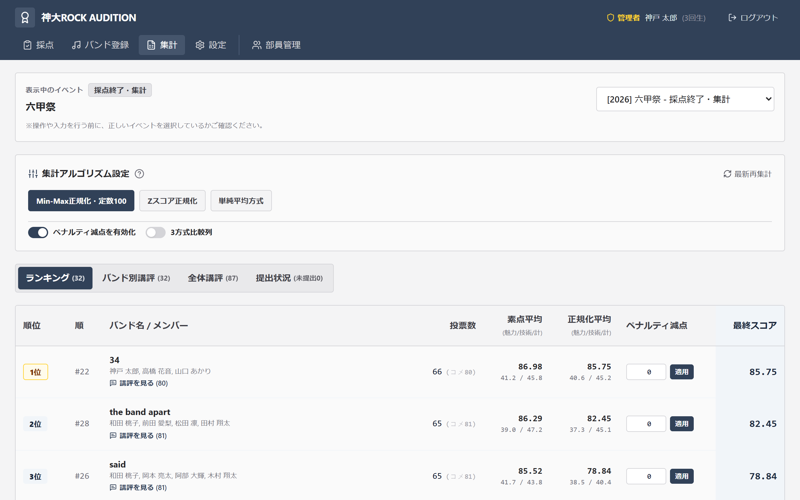

---

### Step 5：「4. 採点終了・集計」への切り替えと結果公開・Excel出力
1. 採点が完了したら、**「設定」** タブの **「1. 進行ステータス」** から **「4. 採点終了・集計」** に切り替えます。
   - **一般部員への公開条件**：ステータスが「4. 採点終了・集計」になり、かつ **採点必須（採点＋コメント）の対象者全員が提出済み** になると、一般部員も **「集計」** タブからランキング・バンド別講評・全体講評の閲覧と、Excel/CSVダウンロードができるようになります。
2. **「集計」** タブ下部の **「Excel / CSV データエクスポート」** から、用途別に2種類のファイルをダウンロードできます（`.xlsx` / `.csv` どちらも対応）。
   - **① 集計結果＆全採点データ（Excel 4シート数式連動構成）**
     - 運営保管・検算・シミュレーション用です。以下の4シートで構成されており、`.xlsx` 版では各シートが Excel 数式で連動しているため、「全採点データ_補正過程」の素点や「総合ランキング集計」上部の採用集計方式・基準点差定数・ペナルティ設定を変更すると順位まで自動再計算されます。
       - **1シート目「総合ランキング集計」**：出演順に行を並べ、各バンドの順位（5段階タイブレーク対応）・有効投票数・素点平均・正規化平均・ペナルティ・最終スコアを数式で算出します。
       - **2シート目「全採点データ_補正過程」**：`scores` テーブルの対象オーディション全レコード（各採点者の素点・自バンド除外フラグ・コメント等）を1行1件で掲載します。
       - **3シート目「審査員別_補正係数」**：2シート目の生データから、審査員ごとの有効採点数・最高点・最低点・点差・補正係数・素点平均・素点標準偏差を数式で算出します。
       - **4シート目「採点者別_補正後スコア表」**：行に採点者、列に全バンド（出演順）を並べ、2・3シート目および1シート目の採用集計方式に応じた補正後合計点を数式で算出します。
   - **② バンド別講評シート（各バンド1シート＋全体講評シート）**
     - 各バンドおよび全部員へのフィードバック確認用です。出演バンドごとに1シート作られ、正規化後の魅力点・技術点・合計点とコメントがまとまっています。末尾に「全体講評」シートも入っています。

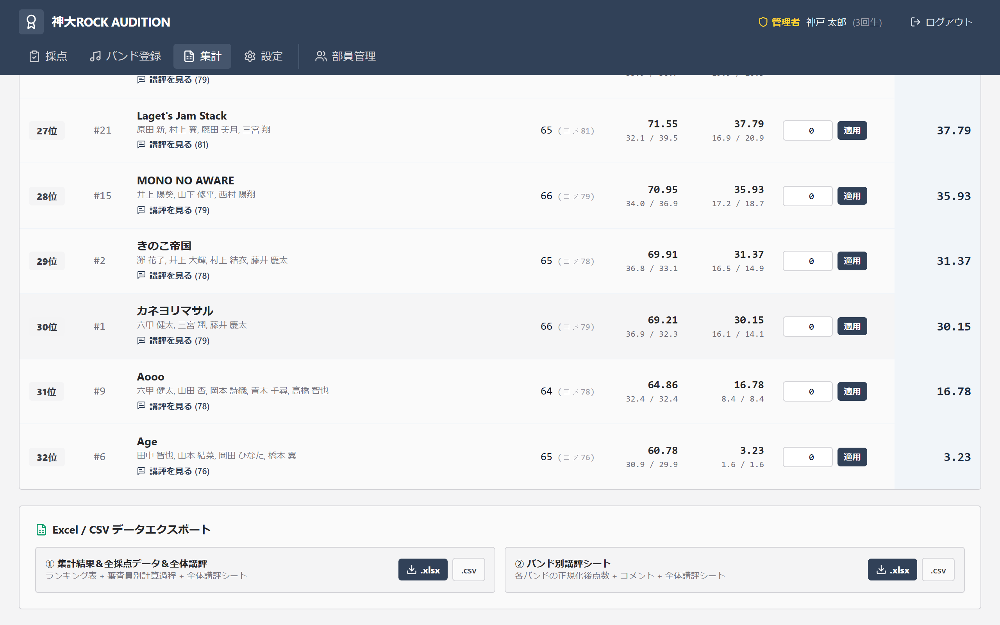

---

## 3. よくあるトラブルと対処法

| 困ったこと | 原因と対処手順 |
| :--- | :--- |
| **直前にバンドメンバーの追加・脱退があった** | 管理者は「募集締切・調整中」や「採点受付中」でも、**「バンド登録」** タブから該当バンドの編集ボタン（鉛筆アイコン）でメンバーを変更できます。変更後、該当部員が画面を再読み込みすると自バンド除外が即座に反映されます。 |
| **部員が「採点・コメント対象者に登録されていません」と表示される** | **「設定」** タブの **「2. 採点・コメント義務設定」** を開き、氏名検索や「不参加」で絞り込んで該当部員を見つけ、行右側の **「採点＋コメント」** または **「コメントのみ」** を押してください。即座に入力できるようになります。 |
| **ログイン時に「部員マスタに登録されていないアカウントです」と出る** | 部員名簿にその部員の学籍番号が登録されていません。**「部員管理」** タブの「部員マスタ 一括登録・更新」から、その部員の学籍番号と氏名を登録してから再ログインしてもらってください。 |
| **ログイン時に「許可されていないドメイン」と出る** | 個人の `@gmail.com` 等でログインしようとしています。学内Googleアカウント（`@stu.kobe-u.ac.jp` 等）を選び直してログインするよう案内してください。 |
| **初回ログイン時に「氏名・回生の登録」画面が出た** | 名簿から一括登録した直後の初回ログイン時に表示される確認画面です。自分の氏名（苗字と名前の間にスペース）と現在の回生を選んで **「この回生で確定する」** を押してもらってください。 |
| **会場の電波が悪く、採点が送信できない** | 入力内容は自動でスマホ端末内に下書き保存されるため、ブラウザを閉じても消えません。電波の良い場所へ移動し、画面上部の **「未同期 (○件) を同期」** ボタンを押すよう案内してください。 |
| **「採点終了・集計」にしたのに一般部員が結果を見られない** | 採点必須（採点＋コメント）の対象者に未提出者が残っていると、一般部員には公開されません。**「集計」→「提出状況」** タブで未提出者を確認し、提出を完了してもらうか、欠席等で不要な場合は「設定」タブの「2. 採点・コメント義務設定」で「不参加」に変更してください。 |
| **募集締切や採点締切を過ぎてしまい、入力・修正できなくなった** | **「設定」** タブの **「1. 進行ステータス」** 下部にある「バンド募集締切」または「採点締切」を未来の日時に変更して **「締切を保存」** を押すと、再び入力・修正できるようになります。 |
| **半年以上前の過去イベントが一覧に出てこない** | 一覧を見やすくするため、半年以上前のイベントは自動で非表示になっています。画面上部のイベント選択エリアにある **「半年以上前のイベントを表示」** スイッチをオンにしてください。 |
| **間違えて作ったイベントを削除したい** | **「設定」** タブの一番下 **「5. 詳細設定・削除」** の **「このイベントを削除」** を押し、確認画面でイベント名を手入力して削除します（※バンドや採点データもすべて消え、元に戻せません）。 |
| **端末故障や緊急障害でアプリから入力できない** | 運営が口頭やメモで点数・コメントを受け取り、**「集計」** タブから **「① 集計結果＆全採点データ」** のExcelファイルをダウンロードして、Excel上での手動集計へ退避してください。 |

---

## 4. 次年度への運営引き継ぎ手順

1. **次期運営委員のアカウント準備**
   - 次期の運営委員が部員名簿に登録されている状態にします（未ログインでも登録済みであれば昇格できます）。
2. **新しい管理者の昇格**
   - 現在の管理者が **「部員管理」** タブを開き、**「一覧を表示」** をクリックして部員一覧を開きます。
   - 次期運営委員の行にある **「管理者へ昇格」** ボタンを押します（再ログイン不要で、次の操作から管理者メニューが表示されます）。
3. **旧管理者の権限解除**
   - 引き継ぎが完了したら、引退する旧運営委員の行にある **「一般部員へ変更」** ボタンを押します。
   - ※ 安全のため、システム内の **最後の1人の管理者は一般部員へ変更・削除できない** 仕組みになっています。必ず新しい管理者を昇格させてから、旧管理者を変更してください。
4. **年度替わりについて**
   - 毎年4月1日になると、登録されている入部年度から全部員の回生が自動で1つ上がります。4回生以上になった部員は、バンド登録のメンバー候補や採点義務設定のリストから自動で非表示になるため、年度替わりの削除作業は不要です。
   - ※ **注意**：部員一覧の **「削除」** ボタンを押すと、その部員が過去に参加したバンド所属や採点データもすべて消えてしまいます。引退しただけの部員は削除せず、そのまま残しておくことをおすすめします。

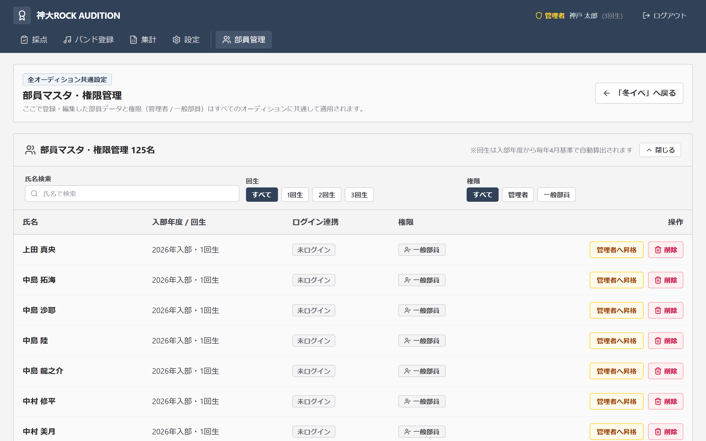
