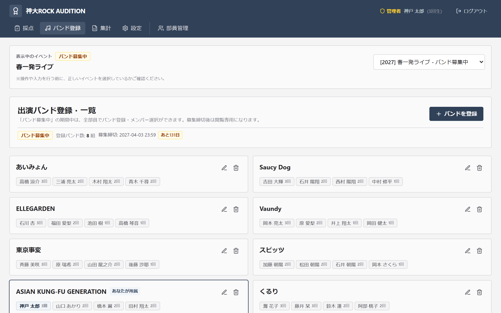
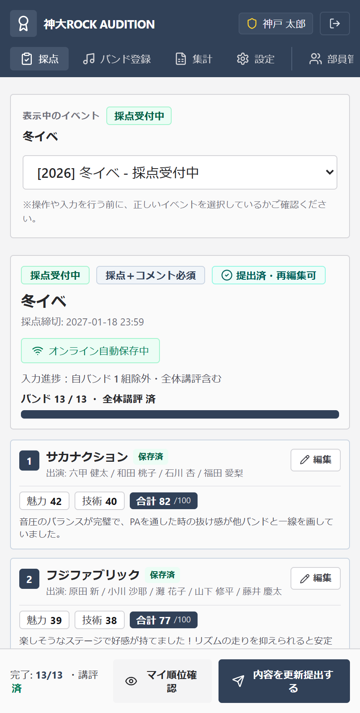
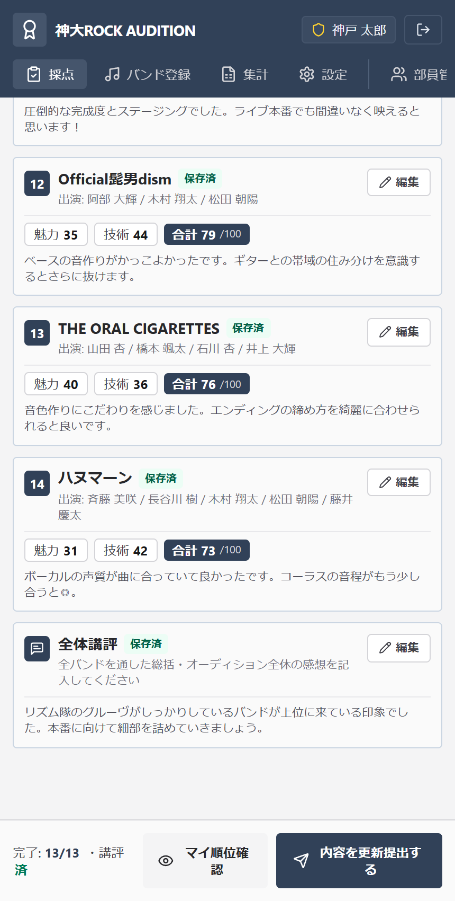

# オーディション採点アプリ 一般部員向けガイド

本ガイドは、一般部員の方がバンド登録から当日のスマホ採点・最終提出、結果閲覧までを迷わず行うための操作マニュアルです。

---

## はじめに：ログインと画面の見方

### ログインと初回設定
1. トップ画面の **「学内Googleアカウントでログイン」** から、学内Googleアカウント（`@gsuite.kobe-u.ac.jp`）でログインします。
   - ※ 個人の `@gmail.com` アカウントではログインできません。
2. 初めてログインしたときは **「氏名・回生（入部年度）の登録」** 画面が表示されます。苗字と名前の間にスペースを入れた氏名と、現在の回生を選んで確定してください。

### 上部メニューとアカウントメニュー
ログインすると画面上部にメニューが表示されます。
- **採点**：演奏を見ながら点数・コメント・全体講評を入力・提出する画面
- **バンド登録**：出演バンドとメンバーを登録・確認する画面。募集締切まで編集できます
- **集計**：結果公開後にランキング・バンド別講評・全体講評の閲覧と Excel / CSV ダウンロードを行う画面

> **表示中のイベント切替・アカウントメニュー**
> - 画面上部の **「表示中のイベント」** プルダウンから、確認・操作したいイベントを切り替えられます。開催日が新しい順に表示されます。
> - 半年以上前の過去イベントを見たいときは、イベント選択欄の **「半年以上前のイベントを表示」** スイッチをオンにしてください。
> - 画面右上の **自分の氏名** を押すとアカウント情報と **「ログアウト」** メニューが開きます。

---

## 1. バンド登録

ステータスが **「1. バンド募集中」** かつ **バンド募集締切前** の間は、どの部員でも自分のバンドを登録・編集できます。

1. 上部メニューから **「バンド登録」** タブを開きます。
2. **「バンドを登録」** ボタンを押し、バンド名を入力します。
3. メンバー欄で現役の1〜3回生から出演メンバーを検索して選択し、保存します。
4. すでに登録されているバンドを修正したい場合は、各バンド右側の編集アイコンから変更できます。

> **ポイント**
> - ここでメンバーとして登録したバンドは、当日の採点画面で **自動的に「自バンド・対象外」** になります。複数バンドの掛け持ちにも対応しています。
> - 募集締切後や当日直前にメンバー変更が必要になった場合は、運営委員に編集を依頼してください。

---

## 2. 当日の採点・コメント入力と提出

イベントのステータスが **「3. 採点受付中」** になると、**「採点」** タブから入力できるようになります。

### 自分の採点区分について
運営委員の設定によって、表示される入力項目が異なります。
- **採点＋コメント**：各バンドの魅力点（0〜50点）・技術点（0〜50点）・コメントと、全体講評を提出します。
- **コメントのみ**：1回生や見学枠などの区分です。点数欄は表示されず、各バンドへのコメントと全体講評のみを提出します。
- **対象外**：採点対象外のため入力不要です。当日参加しているのに「対象外」と表示される場合は、運営委員へ設定変更を依頼してください。

### 採点から最終提出までの流れ
1. **各バンドの入力と保存**
   - 出演順にバンドカードが並びます。自分の所属バンドは自動で **「自バンド・対象外」** としてロックされます。
   - 各バンドの点数とコメントを入力し、**「採点を保存」** を押します。保存するとカードが自動で折りたたまれ、スクロール中の誤操作を防げます。直したいときはカード右上の **「編集」** を押してください。
2. **全体講評の入力**
   - 全バンドのカードの下にある **「全体講評」** カードに、オーディション全体を通しての講評を入力して保存します。最終提出には入力が必須です。
3. **マイ順位確認**
   - 採点＋コメント対象者は、画面下部の **「マイ順位確認」** を開くと自分が付けた点数の高い順にバンドを一覧で確認できます。点数のバランス調整に活用してください。
4. **最終提出する**
   - 全対象バンドと全体講評の入力が終わったら、画面下部の **「最終提出する」** を押します。
   - 採点締切前であれば、提出後も **「内容を更新提出する」** から何度でも修正して再提出できます。

| 採点画面（上部：自バンド除外・入力進捗） | 採点画面（下部：全体講評・マイ順位確認・提出） |
| :---: | :---: |
|  |  |

### 電波が悪いとき
- 入力内容は自動でスマホ端末内に下書き保存されるため、会場の電波が悪くても再読み込みで消えません。
- 電波が回復したタイミングで画面上部の **「未同期 (○件) を同期」** ボタンを押すと、未送信分がまとめてサーバーに保存されます。

### 採点締切を過ぎたあとの動作
- **すでに最終提出済みの人**：締切を過ぎると、それ以降の修正はできなくなります。
- **まだ最終提出していない人**：すでに保存済みのバンドは編集できませんが、**未入力のバンド・全体講評だけ入力して初回の「最終提出する」** を実行できます。

---

## 3. 集計結果・講評の確認

イベントが **「4. 採点終了・集計」** になり、かつ **「採点＋コメント」対象者全員の最終提出が完了** すると、**「集計」** タブから結果を閲覧できるようになります。

- **ランキング** タブ：各バンドの順位、有効投票数、素点平均、正規化後スコア、最終スコアを確認できます。
- **バンド別講評** タブ：バンドを選択すると、全員分のコメントと正規化後の魅力・技術・合計点を確認できます。区分絞り込みやキーワード検索も可能です。
- **全体講評** タブ：部員全員が書いたオーディション全体への講評を確認できます。
- **Excel / CSV データエクスポート**：集計データやバンド別講評シートを `.xlsx` / `.csv` 形式でダウンロードできます。

---

## 4. よくある質問・トラブル対処

| 困ったこと | 確認・対処方法 |
| :--- | :--- |
| **「許可されていないドメイン」と出てログインできない** | 個人の `@gmail.com` 等を選んでいます。大学から付与された学内Googleアカウント（`@gsuite.kobe-u.ac.jp`）でログインし直してください。 |
| **「部員マスタに登録されていないアカウントです」と出る** | 部員名簿に学籍番号が未登録の状態です。運営委員に名簿への登録を依頼してください。 |
| **「採点・コメント対象者に登録されていません」と表示される** | 当日の参加区分が「不参加」になっているか未設定です。運営委員に「採点＋コメント」または「コメントのみ」への変更を依頼してください。 |
| **自分のバンドなのに採点欄が有効になっている** | 「バンド登録」のメンバーに自分が含まれていない可能性があります。運営委員にバンドメンバーの追加を依頼し、追加後に画面を再読み込みしてください。 |
| **会場の電波が悪く「採点を保存」が失敗する** | 入力内容は端末に自動保存されています。ロビーなど電波の良い場所へ移動し、画面上部の **「未同期 (○件) を同期」** ボタンを押してください。 |
| **採点が終わったのに「集計」結果が見られない** | 「採点＋コメント」対象者全員の提出が完了し、運営が「4. 採点終了・集計」へ切り替えるまでは非公開になっています。公開までお待ちください。 |
| **半年以上前のイベントが出てこない** | 画面上部のイベント選択エリアにある **「半年以上前のイベントを表示」** スイッチをオンにすると表示されます。 |
